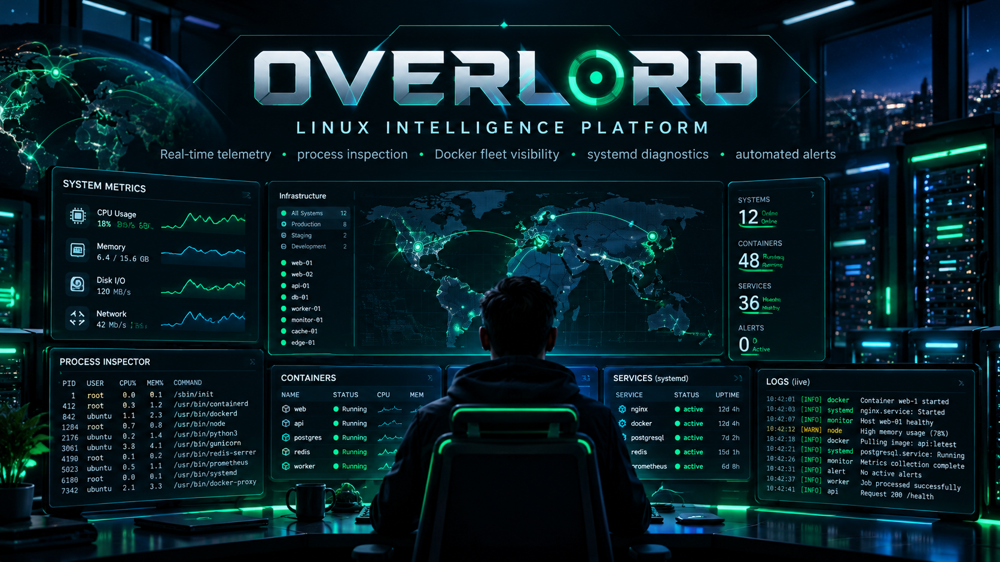

# ◈ OVERLORD — Linux Infrastructure Intelligence



A runnable, local-first Linux control center built with FastAPI, psutil, SQLite, WebSockets, and vanilla JavaScript. **Version 1** includes live CPU and RAM charts, process inspection, systemd read-only inventory, Docker container read-only inventory, disk and network inspection, local threshold alerts, event timeline, point-in-time metadata snapshots, REST API, and data export. Responsive dark UI. No Node tooling required.

## Run on Fedora or Ubuntu (recommended: host-native)

```bash
cd overlord
python3 -m venv .venv
source .venv/bin/activate
pip install -r requirements.txt
# Optional strongly recommended when accessible beyond your own local session:
export OVERLORD_TOKEN="$(python3 -c 'import secrets; print(secrets.token_urlsafe(32))')"
uvicorn app.main:app --host 127.0.0.1 --port 8282
```

Open http://127.0.0.1:8282, click **Token** and paste the token if you set one. API docs: http://127.0.0.1:8282/docs. The browser stores your token in the current tab's sessionStorage.

On another machine, use SSH port forwarding:

```bash
ssh -L 8282:127.0.0.1:8282 yeet
```

Open http://127.0.0.1:8282 on your workstation after the tunnel is established.

## Docker (isolated-container telemetry)

```bash
cp .env.example .env
python3 -c 'import secrets; print(secrets.token_urlsafe(32))'  # paste value in .env
# edit .env and replace REPLACE_WITH_RANDOM_TOKEN
docker compose up -d --build
```

**Important:** In default Docker mode the CPU/memory/process views report the container's namespace or underlying host as seen from the container, and systemd/Docker CLI introspection generally will not work. Run natively on the monitored host for useful system telemetry. This project deliberately does **not** mount docker.sock or use privileged mode.

## Safe by design

- No shell command execution endpoint, restart endpoint, Docker mutation, firewall editing, scanning or automated repairs.
- Rules only **record alert events** when local CPU, RAM, swap, or root disk utilization crosses thresholds. Cooldowns prevent event floods.
- `OVERLORD_TOKEN` protects APIs and WebSocket access. Without it, run on loopback only. The static UI is always publicly served by the web process.
- For external access, use SSH tunnels, VPN, or an authenticated HTTPS reverse proxy; do not expose directly to the open internet. No multi-user role management or TLS terminator is included.
- Snapshots record inventory metadata, **not** filesystem backups or restore points. Docker/service support is read-only and relies on local CLI permissions.
- No AI integration, 3D network discovery, remote agents, or host service control yet. Those are potential future releases, not claims of implemented functionality.

## Test

```bash
pip install pytest httpx
pytest -q
```

## API routes

`/api/status`, `/api/processes`, `/api/disks`, `/api/network`, `/api/services`, `/api/containers`, `/api/diagnostics`, `/api/events`, `/api/rules`, `/api/snapshots`, `/api/snapshots/{id}`, `/api/export`, `/ws`. Use `x-overlord-token` header for API requests when enabled.

## License

MIT. See `LICENSE`.
